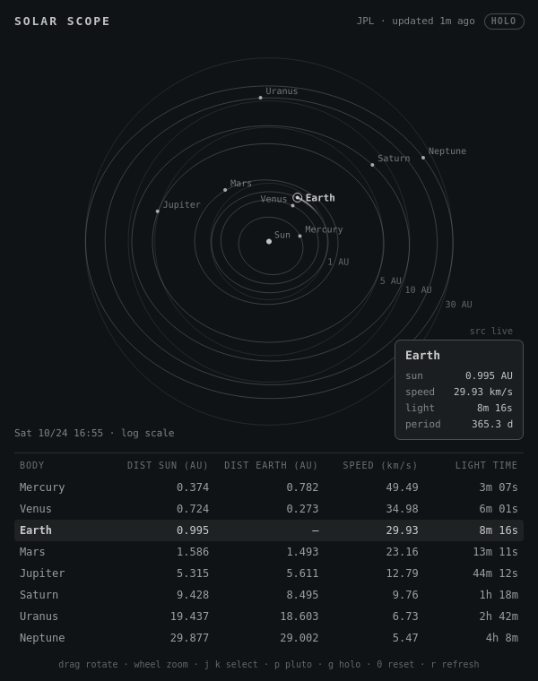

# Solar Scope

A live solar system in the Omarchy bar, drawn as monochrome dots and thin orbits. Click the orbit icon to open the scope, pick a planet, switch to hologram colour, or run time forward at up to 100 days per second.



## Requirements

- Omarchy 4.x (the Quattro shell plugin system)
- `python3`, used only by `update_cache.py` to fetch positions from NASA JPL Horizons. Without it, or when offline, the plugin falls back to JPL approximate orbital elements and still works.

## Install

Install it from the Omarchy plugin marketplace, or run:

```
omarchy plugin add https://github.com/advocu/solar-scope.git --enable
```

The Solar Scope icon then appears on the right of the bar. If it doesn't, run `omarchy-shell shell rescanPlugins` once so the shell picks up the new plugin.

## Remove

```
omarchy plugin remove io.github.advocu.solar-scope
```

To also delete the cache, remove `~/.cache/solar-scope`.

## The panel

- **Header:** `JPL · updated Xm ago` after a successful fetch, `JPL · cached` before the first one, and `· refresh failed` if the latest attempt failed. The HOLO badge shows the colour mode.
- **Scope:** the Sun and the planets on thin orbits. The selected body gets a card (distance from the Sun, speed, light time, period) and its data source (`live`, `cache` or `kepler`).
- **Table:** distance from the Sun and from Earth, speed, and light time.
- **Playback:** time can run forward from live at 1, 3, 5, 30 or 100 days per second, and loops after one Neptune orbit.
- **Plain / holo:** plain uses the bar foreground colour; holo uses the theme accent with a soft glow. The choice persists across restarts.

A hint line at the bottom of the panel lists the controls.

## Keys and mouse

| Input | Action |
|---|---|
| Drag, `h` `l` or `←` `→` | Rotate the view |
| Mouse wheel, `+` / `=`, `-` | Zoom in / out |
| `↑` `↓` | Tilt |
| `j` / `Tab`, `k` / `Shift+Tab` | Select next / previous body |
| Click a body or table row | Select it |
| Click the HOLO badge, or `g` | Toggle holo mode |
| `Space` or `n` | Show or hide names |
| `.` | Play, or pause and return to live |
| `[` / `]` | Slower / faster (1, 3, 5, 30, 100 d/s) |
| `p` | Show or hide Pluto |
| `0` | Return to live, or reset the view if already live |
| `r` | Refresh JPL data now |
| `Esc` | Deselect, or close the panel if nothing is selected |

## Data and refresh

Positions come from `Orbits.js` (pure JS, with `bodies.json` bundled as `bodies-data.js`). They are recomputed only while the panel is open. Order of preference: live JPL samples, then the yearly cache, then orbital elements.

Files live in `$XDG_CACHE_HOME/solar-scope/ephemeris/` (fallback `~/.cache/solar-scope/ephemeris/`): `<id>.json` (daily, ±1 year), `live.json` (30-minute samples around now) and `status.json`. The panel picks up changes automatically.

About 10 seconds after shell start, and then every 30 minutes, `update_cache.py` runs in the background and contacts NASA JPL Horizons: a full refresh when the yearly cache is missing, older than 7 days, or within 90 days of its end; otherwise `--live` (skipped if `live.json` is under 25 minutes old).

`r` (or `omarchy-shell solarscope refresh`) forces a live update. Manual refreshes are limited to one per 60 seconds, runs never overlap, and the panel never waits on them.

You can also control the plugin from a terminal or a keybinding:

```
omarchy-shell solarscope open|close|toggle
omarchy-shell solarscope select <id>
omarchy-shell solarscope refresh
omarchy-shell solarscope setSpeed 1|3|5|30|100
omarchy-shell solarscope setPlaying true|false
omarchy-shell solarscope setHolo true|false
omarchy-shell solarscope setNames true|false
omarchy-shell solarscope state
```

## Privileges

No sudo, hooks, or extra packages. The only network access is `update_cache.py` talking to `ssd.jpl.nasa.gov`. The plugin writes under `~/.cache/solar-scope` and its own Omarchy plugin settings (holo, Pluto, names). It does not edit your Hyprland or shell configuration.

## License

MIT. See `LICENSE`.

Camera, projection and hologram glow parameters in `SolarScopeView.qml` are adapted from [Asteroid Radar](https://github.com/mechurisr/omarchy-asteroid-radar), MIT License, Copyright (c) 2026 chanwook lee. See `THIRD_PARTY.md`.
